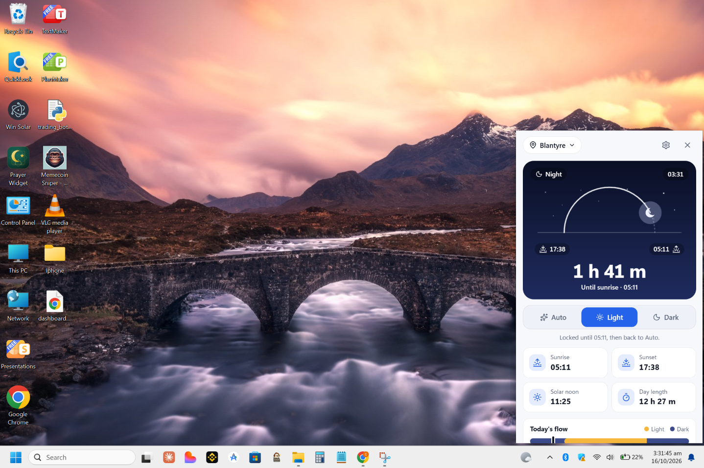
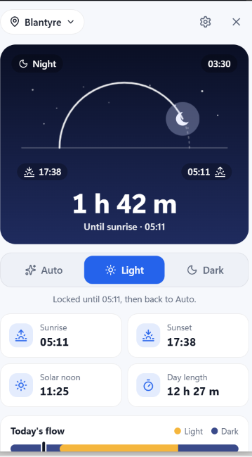
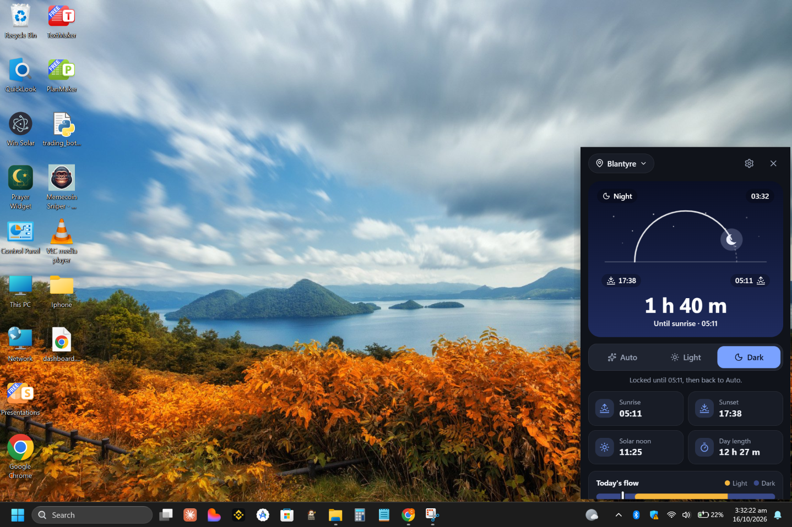
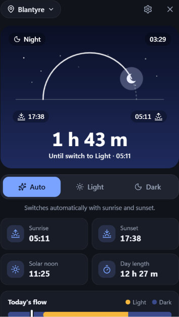

#  Win Solar

**Win Solar** is a lightweight Windows application that automatically switches your system between light and dark themes based on local sunrise and sunset times.

---

## ✨ Features
- **Automatic Theme Switching:** Dynamically toggles Windows light/dark mode according to real-time solar calculations.
- **Location-Based:** Computes exact sunrise and sunset times based on your local coordinates.
- **Seamless & Lightweight:** Runs quietly in the background with minimal resource usage.

---

## 📥 Download & Installation

You can download the latest stable release from the [Releases](https://github.com/celalcelikkaya/win-solar/releases) page.

1. Go to the [Releases Page](https://github.com/celalcelikkaya/win-solar/releases).
2. Download the `Setup.zip` file from the latest version.
3. Extract and run the application.

---

## 🛠️ Build from source

Requirements: Windows, [Node.js](https://nodejs.org) 20 or newer.

| Command | What it does |
|---|---|
| `start.bat` / `npm run dev` | Opens the interface in the browser (development) |
| `start-desktop.bat` / `npm run desktop` | Builds and starts the desktop app |
| `build-exe.bat` / `npm run dist` | Builds the Windows installer into `release/` |
| `npm run dist:portable` | Builds a portable `.exe` |
| `npm run lint` | Type check |

```
src/        interface (React + TypeScript): App.tsx, components/, lib/ (sun times, scheduler, places, i18n)
electron/   desktop shell: main.cjs (window, theme switching), tray.cjs, windows.cjs (Windows theme registry), preload.cjs
public/     icons used by the interface
build/      installer icon
docs/       screenshots used in this README
```

---

## 🖼️ Screenshots

| Light Mode | Dark Mode |
| :---: | :---: |
|  <br>  |  <br>  |
